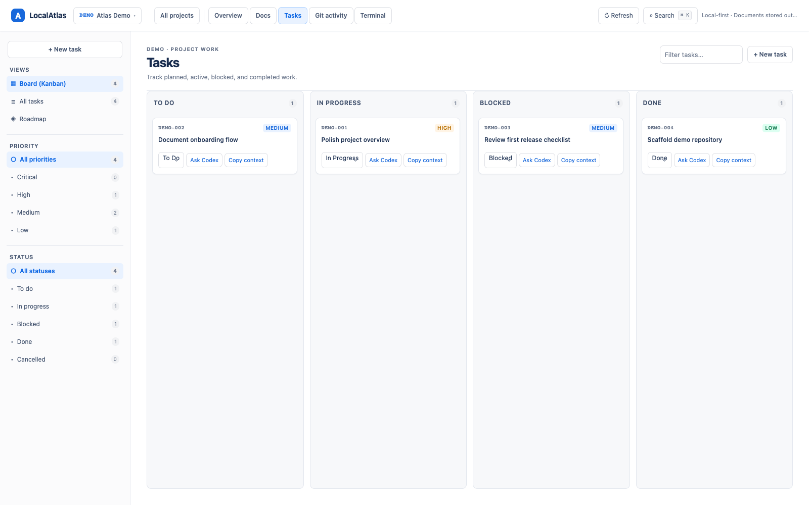

# LocalAtlas

**A local-first workspace for project documentation, tasks, and coding-agent context.**

Import existing repositories without changing their files. Keep project plans and tasks in readable Markdown, then work with them from the browser app, desktop app, or CLI.



## What you can do

- See projects, open tasks, and recent Git activity in one workspace.
- Keep editable Atlas documents and tasks as Markdown outside imported repositories.
- Browse repository Markdown and Git history as read-only project context.
- Give coding agents bounded, project-scoped context through the shared CLI and core.
- Use the same Node.js core from the local web app, CLI, and Tauri desktop shell.

## Get started

Requires Node.js 22.5 or newer.

```bash
npm install
npm run build
npm run cli -- import /absolute/path/to/project --key SAV
npm run dev
```

Open [http://127.0.0.1:3456](http://127.0.0.1:3456). LocalAtlas stores its workspace in `~/.localatlas` by default; set `LOCALATLAS_HOME` to use another location.

For a quick CLI check:

```bash
npm run cli -- projects
npm run cli -- task list --project SAV
```

See the [CLI reference](docs/CLI.md) for all commands and options.

## Desktop app

The Tauri v2 shell opens the same local interface and starts the shared Node.js backend. Rust is required for development and packaging.

```bash
npm run tauri:dev
npm run tauri:build
```

The desktop app requires Node.js 22.5 or newer on the machine. Set `LOCALATLAS_NODE_PATH` if Node.js is not available on `PATH`.

## Data and security

- Markdown is the canonical source for Atlas documents, tasks, profiles, and sessions. SQLite stores the project registry and rebuildable indexes.
- Imported source files remain separate from editable Atlas documents. Import, browsing, and LocalAtlas document operations do not write to source repositories.
- The local server binds to `127.0.0.1` and validates request origins and hosts.

## Architecture diagrams

Explore the [system architecture](docs/diagrams/localatlas-system.architecture.html), the [task-scoped Codex flow](docs/diagrams/task-scoped-codex.sequence.html), or the [diagram index](docs/diagrams/README.md).

## Development

```bash
npm run typecheck
npm test
npm run build
npx playwright install chromium # one-time setup for browser UI tests
npm run test:e2e
```

Read the [vision](docs/VISION.md), [architecture](docs/ARCHITECTURE.md), [file format](docs/FILE_FORMAT.md), [roadmap](docs/ROADMAP.md), and [agent guidelines](AGENTS.md).
